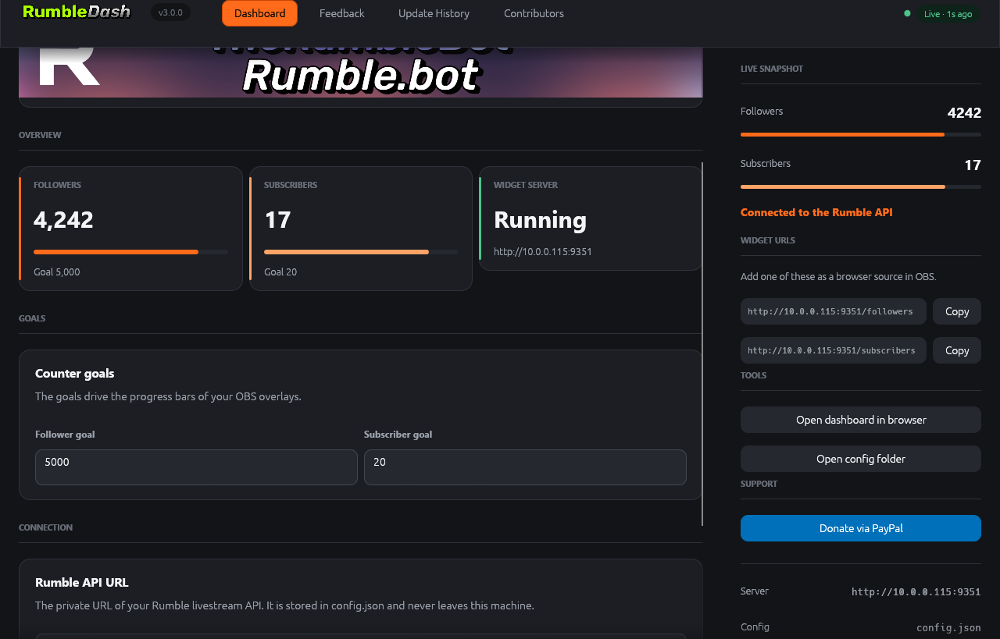

# RumbleDash



**The Ultimate Dashboard for Rumble Streamers.**

RumbleDash watches your Rumble channel in real time, shows your follower and
subscriber counts against the goals you set, and serves drop-in OBS browser-source
widgets so the numbers can live directly on your stream.

Version 3 replaces the old Express + HTML web app with a **native desktop
application** written in Rust with [egui](https://github.com/emilk/egui). The HTTP
contract, the `config.json` format and the widget URLs are unchanged, so every
existing OBS source keeps working.

| Release  | Stack                    | Where it lives                   |
|----------|--------------------------|----------------------------------|
| **v3.0.0** | Rust · egui · axum      | [`RustPort/RumbleDash-v3/`](RustPort/RumbleDash-v3) |
| v2.28    | Node.js · Express · HTML | [`RumbleDash-v2.28/`](RumbleDash-v2.28) (legacy) |

---

## Download

**[⬇ Download the latest release](https://github.com/CustomBAR/RumbleDash/releases/latest)**

Every release ships two builds, produced by
[`.github/workflows/build.yml`](.github/workflows/build.yml):

| Platform | File | Contents |
| --- | --- | --- |
| Windows x64 | `RumbleDash-<version>-windows-x64.zip` | `rumbledash.exe`, `rumbledash-server.exe` |
| Linux x64 | `RumbleDash-<version>-x86_64.AppImage` | the desktop app, ready to run |
| Linux x64 | `RumbleDash-<version>-linux-x64.tar.gz` | both binaries, for anyone who prefers a plain tarball |

To run the AppImage:

```bash
chmod +x RumbleDash-*.AppImage
./RumbleDash-*.AppImage
```

If your distribution has no FUSE, run it with
`APPIMAGE_EXTRACT_AND_RUN=1 ./RumbleDash-*.AppImage` instead.
No runtime, no installer, no Node.js required.

---

## Features

* **Live counters** – followers and subscribers are polled from the Rumble API
  with a 5 second cache and pushed straight into the interface.
* **Goal progress** – set a follower goal and a subscriber goal and watch the
  bars fill; the dashboard shows the percentage, the OBS widgets show the bar.
* **OBS widgets** – copy the widget URL from the right rail, paste it into an OBS
  *Browser* source, done. The widgets are compiled into the binary, so they work
  from any folder and any machine.
* **One app, one config** – the desktop app embeds the widget server, so the
  widget URLs always point at a running server. A headless server binary is
  included for people who only want the widgets.
* **A real interface** – a charcoal dashboard with a single ember accent, a live
  status chip, one-click copy buttons and a right rail that stays aligned to the
  pixel.
* **Everything from v2, still here** – the feedback form, the update history and
  the contributors wall all moved into the app; the old URLs still resolve and
  redirect to the app.

---

## Repository layout

```
RumbleDash/
├── docs/                     # screenshots used by the README and the site
├── assets/                   # logo and OBS widget artwork for GitHub Pages
├── index.html, styles.css    # the GitHub Pages landing page
├── script.js                 # the landing page animations (no dependencies)
├── RumbleDash-v2.28/         # the legacy Node.js app (v2.28), kept for reference
└── RustPort/
    └── RumbleDash-v3/        # the current app – a Rust workspace
        └── crates/
            ├── rumbledash-core/    # config, Rumble API client, cache, data model
            ├── rumbledash-server/  # axum HTTP server + embedded widget assets
            └── rumbledash-app/     # the egui desktop application
```

The landing page is plain HTML, CSS and one dependency-free script – no build step,
no framework. It is deployed by `.github/workflows/static.yml`.

---

## Build from source

You need a [Rust toolchain](https://rustup.rs/) (stable, 2021 edition or newer).

```bash
git clone https://github.com/CustomBAR/RumbleDash.git
cd RumbleDash/RustPort/RumbleDash-v3

cargo run --bin rumbledash          # the desktop app (starts the widget server)
cargo run --bin rumbledash-server   # headless widget server only
```

For a release build:

```bash
cargo build --release
# -> target/release/rumbledash.exe
# -> target/release/rumbledash-server.exe
```

<details>
<summary>Windows toolchain note</summary>

On Windows the MSVC toolchain needs the Visual Studio Build Tools linker. If
`link.exe` is missing, build with the GNU toolchain instead:

```powershell
$env:PATH = "$env:USERPROFILE\.cargo\bin;$env:PATH"
cargo build --workspace
```

</details>

### Configuration

`config.json` is read from the working directory – byte-compatible with v2, so an
existing installation can be dropped straight in:

```json
{
  "apiUrl": "",
  "goals": {
    "followers": 50,
    "subscribers": 2
  }
}
```

| Environment variable | Meaning                             | Default       |
|---------------------|-------------------------------------|---------------|
| `RUMBLE_DASH_CONFIG` | path of the `config.json` to use  | `./config.json` |
| `RUMBLE_DASH_PORT`   | TCP port for the widget server     | `9000`        |
| `PORT`               | fallback for `RUMBLE_DASH_PORT`   | `9000`        |

---

## OBS widgets

1. Start RumbleDash – the desktop app or the headless server.
2. Copy a widget URL from the right rail, e.g. `http://192.168.1.20:9000/followers`.
3. In OBS add a **Browser** source and paste the URL.

| Widget      | URL            | Shows                                  |
|-------------|----------------|----------------------------------------|
| Followers   | `/followers`   | follower count and goal progress bar   |
| Subscribers | `/subscribers` | subscriber count and goal progress bar |

A small browser status page with the live numbers is served at `/`.

---

## Documentation

* [`RustPort/RumbleDash-v3/README.md`](RustPort/RumbleDash-v3/README.md) – the full
  v3 documentation: interface design, HTTP API, the v2 → v3 mapping and the
  development workflow.
* [`RustPort/README.md`](RustPort/README.md) – how the two versions relate.

---

## License

MIT – see [`LICENSE`](LICENSE).
